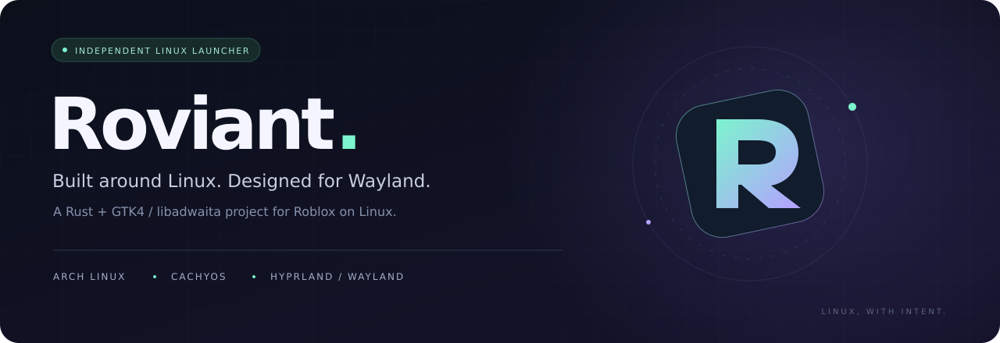
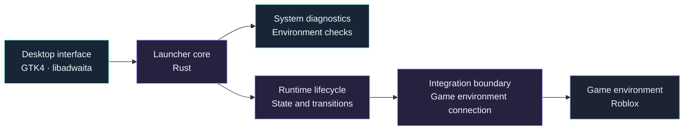
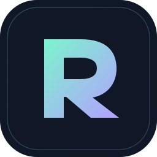

  

  <a href="README.md"><strong>English</strong></a> &nbsp; / &nbsp; <a href="README.ru.md">Русский</a>

  
  
  
  

<h3 align="center">A Linux launcher with a clear view of your system.</h3>

  An independent Rust project for launching Roblox on Arch Linux and CachyOS. 
  A native GTK4 interface, a focus on Hyprland / Wayland, and a deliberate runtime lifecycle.

  <a href="#the-project">Overview</a> &nbsp; · &nbsp;
  <a href="#designed-around-linux">Design</a> &nbsp; · &nbsp;
  <a href="#architecture-direction">Architecture</a> &nbsp; · &nbsp;
  <a href="#project-status">Status</a> &nbsp; · &nbsp;
  <a href="https://github.com/freeztin/Roviant/issues">Feedback</a>

---

## The project

**Roviant** is an independent Linux launcher written in **Rust**, with **GTK4 / libadwaita** as its interface foundation. Its goal is to make the path from a Linux desktop to a Roblox session easier to understand: inspect the system, identify runtime readiness, and connect the game environment through a clearly defined boundary.

The project targets **Arch Linux** and **CachyOS**, with particular attention to **Hyprland** and **Wayland**.

> [!NOTE]
> **Repository status:** this repository currently contains the project overview and visual identity. Application source code, releases, and installation instructions have not been published here yet. The capabilities below describe the intended project direction.

## Designed around Linux

<table>
<tr>
<td width="50%" valign="top">

### 01 / Native interface

A **GTK4 / libadwaita** desktop experience built in Rust. A focused interface for understanding launch readiness and the state of the game environment.

</td>
<td width="50%" valign="top">

### 02 / System diagnostics

A place for checking the environment before launch and presenting actionable diagnostics, with **Arch Linux, CachyOS, Hyprland, and Wayland** as the primary context.

</td>
</tr>
<tr>
<td width="50%" valign="top">

### 03 / Runtime lifecycle

Explicit runtime states and transitions, so preparation, readiness, launch, and failures can be represented clearly in the interface.

</td>
<td width="50%" valign="top">

### 04 / Controlled integration

A security-conscious connection architecture with a defined boundary between the launcher and the game environment. Integration behavior should be explicit and inspectable.

</td>
</tr>
</table>

## Target environment

| Layer | Project focus |
| :--- | :--- |
| **Distributions** | Arch Linux · CachyOS |
| **Desktop session** | Wayland, with a focus on Hyprland |
| **Implementation language** | Rust |
| **Interface toolkit** | GTK4 · libadwaita |
| **Game environment** | Roblox, accessed through a separate runtime integration |

These are design targets, not a compatibility certification. Other distributions and desktop sessions are outside the current documented scope.

## Architecture direction

The proposed separation keeps interface concerns, system inspection, runtime management, and game integration understandable on their own.

**Design principles**

- **Visible state.** Surface runtime readiness and failures instead of leaving the user to infer what happened.
- **Defined boundaries.** Keep diagnostics, lifecycle management, and game integration distinct.
- **Explicit behavior.** Make launch and connection actions understandable and traceable.
- **Native context.** Treat the Linux desktop and its session environment as a primary design concern.

The diagram describes an architectural direction; it does not assert that these modules are already implemented or audited.

## Project status

| Area | Current public status |
| :--- | :--- |
| Project overview & visual identity | Available in this repository |
| Application source code | Not yet published here |
| Runtime integration details | Not yet documented here |
| Builds & installation guide | Not yet published here |
| Verified game compatibility | Not established by this repository |

An installation guide will need to accompany a runnable release and its actual dependencies. There are no installation commands to run from this repository at present.

Roviant is an independent project and is not affiliated with or endorsed by Roblox Corporation. Actual launch support will depend on the selected runtime and its compatibility with Roblox.

## Follow the project

Use [Issues](https://github.com/freeztin/Roviant/issues) for questions, ideas, and environment-specific feedback. For a future diagnostic report, include the distribution, desktop session, relevant versions, and a concise description of the behavior. Remove credentials and other private information from logs before sharing them.

For published builds, check [Releases](https://github.com/freeztin/Roviant/releases).

---

   
  <strong>Roviant</strong> 
  Independent by design. Linux at the core.  
  <a href="README.ru.md">Читать на русском →</a>

