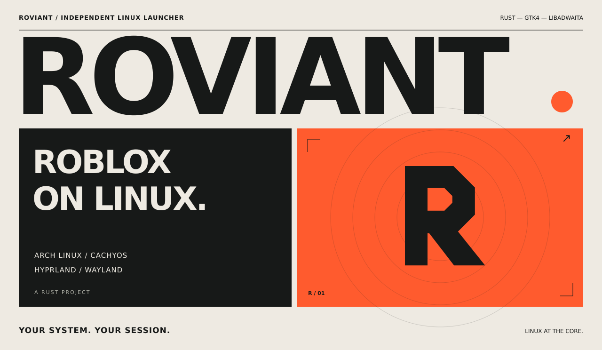
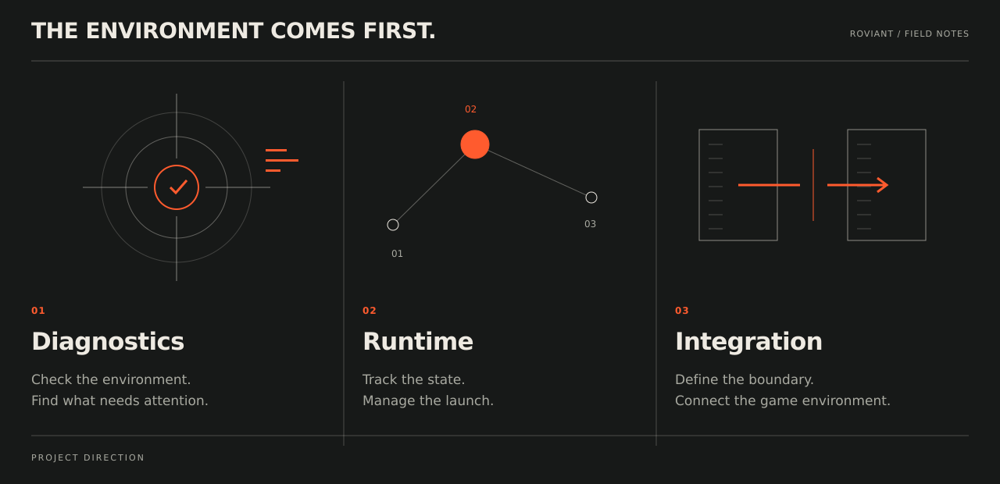
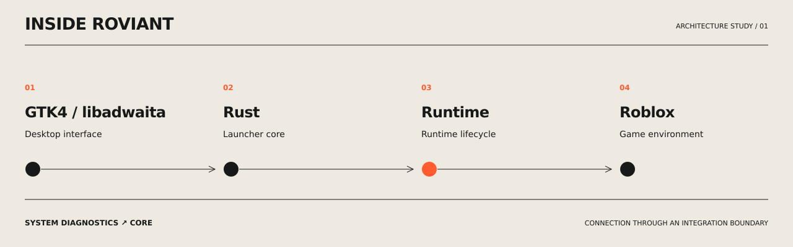

<a href="README.ru.md">РУССКИЙ</a> &nbsp; / &nbsp; <strong>ENGLISH</strong>

### A launcher for the Linux desktop.

Roviant is an independent project for launching Roblox on **Arch Linux** and **CachyOS**, written in **Rust** with **GTK4 / libadwaita**. Its focus is **Hyprland and Wayland**: the environment you already use, with a native desktop interface.

The launcher brings together system diagnostics, runtime state management and a defined connection to the game environment.

 

### Before the game starts.

Roviant is designed to show whether the system and runtime are ready, what is happening during launch, and where a failure occurred. Diagnostics and runtime states belong in the launcher, where you can see them.

 

### Under the hood.

The architecture separates the interface, system diagnostics, runtime lifecycle and game integration. The runtime connection has its own boundary, so the core can manage states without mixing launch logic into the interface.

This is the project’s design direction. Application source code and builds have not been published in this repository yet; installation instructions will follow a runnable release.

---

[Report an issue](https://github.com/freeztin/Roviant/issues) &nbsp; ↗ &nbsp; [Releases](https://github.com/freeztin/Roviant/releases) &nbsp; ↗ &nbsp; [По-русски](README.ru.md)

Roviant is an independent project, not affiliated with Roblox Corporation. Launch compatibility depends on the game runtime.
