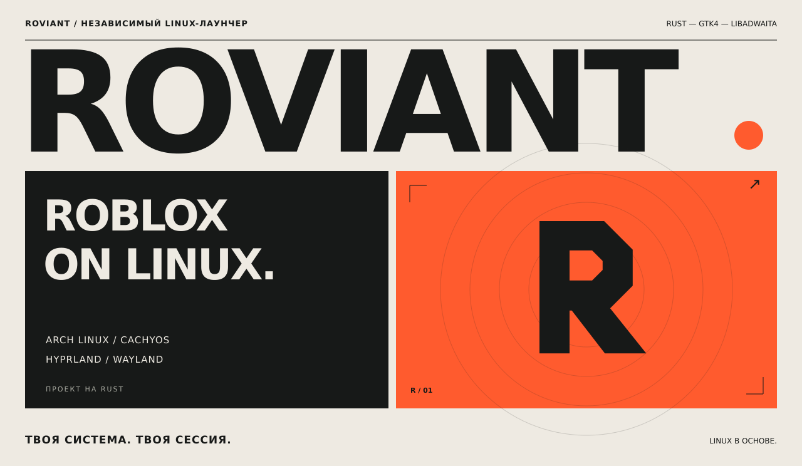
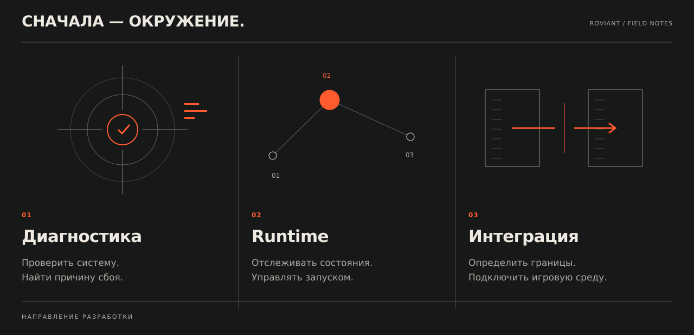
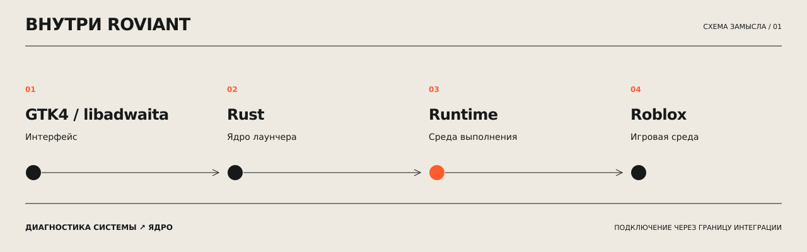

<strong>РУССКИЙ</strong> &nbsp; / &nbsp; <a href="README.md">ENGLISH</a>

### Лаунчер для Linux-десктопа.

Roviant — независимый проект для запуска Roblox на **Arch Linux** и **CachyOS**, написанный на **Rust** с **GTK4 / libadwaita**. В фокусе — **Hyprland и Wayland**: привычное окружение и нативный десктопный интерфейс.

Лаунчер объединяет диагностику системы, управление состояниями runtime и подключение игровой среды через отдельный слой интеграции.

 

### До начала игры.

Roviant задуман так, чтобы было видно, готовы ли система и runtime, что происходит при запуске и на каком этапе возникла ошибка. Диагностика и состояния среды выполнения должны быть перед глазами — прямо в лаунчере.

 

### Что внутри.

Архитектура разделяет интерфейс, диагностику системы, жизненный цикл runtime и игровую интеграцию. Подключение runtime вынесено за отдельную границу: ядро управляет состояниями, а логика запуска не смешивается с интерфейсом.

Это направление разработки проекта. Исходный код приложения и сборки пока не опубликованы в этом репозитории; инструкция по установке появится вместе с рабочим релизом.

---

[Сообщить о проблеме](https://github.com/freeztin/Roviant/issues) &nbsp; ↗ &nbsp; [Релизы](https://github.com/freeztin/Roviant/releases) &nbsp; ↗ &nbsp; [In English](README.md)

Roviant — независимый проект, не связанный с Roblox Corporation. Совместимость запуска зависит от игровой среды выполнения.
