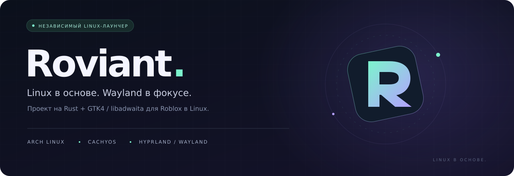
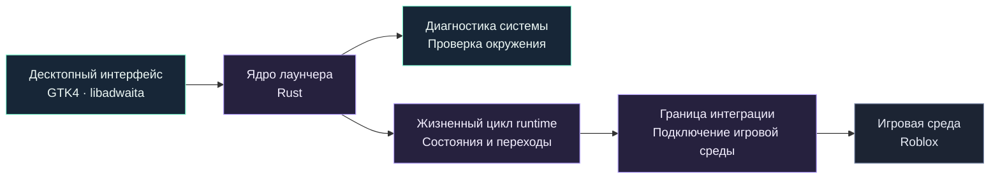

  

  <a href="README.md">English</a> &nbsp; / &nbsp; <a href="README.ru.md"><strong>Русский</strong></a>

  
  
  
  

<h3 align="center">Linux-лаунчер, с которым понятно состояние системы.</h3>

  Независимый проект на Rust для запуска Roblox на Arch Linux и CachyOS. 
  Нативный интерфейс GTK4, фокус на Hyprland / Wayland и управление жизненным циклом runtime.

  <a href="#о-проекте">О проекте</a> &nbsp; · &nbsp;
  <a href="#создаётся-для-linux">Возможности</a> &nbsp; · &nbsp;
  <a href="#направление-архитектуры">Архитектура</a> &nbsp; · &nbsp;
  <a href="#статус-проекта">Статус</a> &nbsp; · &nbsp;
  <a href="https://github.com/freeztin/Roviant/issues">Обратная связь</a>

---

## О проекте

**Roviant** — независимый Linux-лаунчер на **Rust** с интерфейсом на **GTK4 / libadwaita**. Его цель — сделать путь от Linux-десктопа до игровой сессии Roblox понятнее: проверить систему, определить готовность runtime и подключить игровую среду через явно определённую границу интеграции.

Основные целевые системы — **Arch Linux** и **CachyOS**. Особое внимание уделяется **Hyprland** и **Wayland**.

> [!NOTE]
> **Состояние репозитория:** сейчас здесь опубликованы описание проекта и визуальное оформление. Исходный код приложения, сборки и инструкции по установке пока не опубликованы. Возможности ниже описывают направление развития проекта.

## Создаётся для Linux

<table>
<tr>
<td width="50%" valign="top">

### 01 / Нативный интерфейс

Десктопный интерфейс на **GTK4 / libadwaita** и Rust. В центре внимания — готовность к запуску и понятное отображение состояния игровой среды.

</td>
<td width="50%" valign="top">

### 02 / Диагностика системы

Проверка окружения перед запуском и диагностика, помогающая понять причину проблемы. Основной контекст — **Arch Linux, CachyOS, Hyprland и Wayland**.

</td>
</tr>
<tr>
<td width="50%" valign="top">

### 03 / Жизненный цикл runtime

Явные состояния среды выполнения и переходы между ними: подготовка, готовность, запуск и ошибки должны понятно отражаться в интерфейсе.

</td>
<td width="50%" valign="top">

### 04 / Контролируемая интеграция

Архитектура подключения с акцентом на безопасность и чёткую границу между лаунчером и игровой средой. Действия интеграции должны быть явными и доступными для проверки.

</td>
</tr>
</table>

## Целевое окружение

| Уровень | Фокус проекта |
| :--- | :--- |
| **Дистрибутивы** | Arch Linux · CachyOS |
| **Графическая сессия** | Wayland, с акцентом на Hyprland |
| **Язык реализации** | Rust |
| **Интерфейс** | GTK4 · libadwaita |
| **Игровая среда** | Roblox через отдельную интеграцию runtime |

Это ориентиры разработки, а не подтверждение совместимости. Другие дистрибутивы и графические сессии пока не входят в описанный здесь объём проекта.

## Направление архитектуры

Предлагаемое разделение позволяет отдельно рассматривать интерфейс, проверку системы, управление runtime и подключение игровой среды.

**Принципы проектирования**

- **Видимое состояние.** Показывать готовность runtime и причины ошибок, чтобы пользователю не приходилось догадываться о результате.
- **Чёткие границы.** Разделять диагностику, управление жизненным циклом и игровую интеграцию.
- **Явное поведение.** Делать запуск и подключение среды понятными и отслеживаемыми.
- **Linux в основе.** Учитывать особенности десктопа и графической сессии при проектировании.

Схема описывает направление архитектуры и не означает, что эти модули уже реализованы или прошли аудит.

## Статус проекта

| Область | Текущий публичный статус |
| :--- | :--- |
| Описание проекта и визуальное оформление | Доступны в этом репозитории |
| Исходный код приложения | Пока не опубликован здесь |
| Детали интеграции runtime | Пока не описаны здесь |
| Сборки и инструкция по установке | Пока не опубликованы здесь |
| Проверенная совместимость с игрой | Не подтверждена этим репозиторием |

Инструкция по установке должна сопровождать рабочую сборку и описывать её фактические зависимости. Сейчас в этом репозитории нет команд для установки приложения.

Roviant — независимый проект, не связанный с Roblox Corporation и не одобренный ею. Фактическая возможность запуска будет зависеть от выбранной среды выполнения и её совместимости с Roblox.

## Следить за проектом

В [Issues](https://github.com/freeztin/Roviant/issues) можно задавать вопросы, предлагать идеи и оставлять обратную связь об окружении. Для будущего диагностического отчёта укажите дистрибутив, графическую сессию, относящиеся к проблеме версии и краткое описание поведения. Перед публикацией логов удаляйте учётные данные и другую личную информацию.

Опубликованные сборки можно будет найти в [Releases](https://github.com/freeztin/Roviant/releases).

---

   
  <strong>Roviant</strong> 
  Независимый по замыслу. Linux в основе.  
  <a href="README.md">Read in English →</a>

